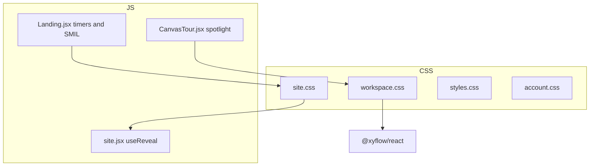

# DesignRounds animation scope map

Read-only inventory classified with the **animate** skill lens (frequency gate, purpose, tool, tokens). Generated from `src/styles/*`, `src/styles.css`, and motion-related React in `src/`.

**Bar for fixes:** use the `improve-animations` skill and its `AUDIT.md` + self-contained plans; this document does not prescribe implementation.

---

## 1. Stack and motion surface

| Layer | File | Role |
| --- | --- | --- |
| Site / marketing / learn | `src/styles/site.css` | `--ease` token; `lp-*` choreography; `.rise` / `.reveal`; library `.round` cards |
| Workspace / interview | `src/styles/workspace.css` | Canvas chrome, streaming UI, tour, incident states |
| Legacy shell | `src/styles.css` | `modal-in`, legacy `card-in`, mobile menu, prompt modals |
| Account | `src/styles/account.css` | Loader spin, user menu popover |
| Library page | `src/styles/library.css` | Hover transitions only (3 rules) |

**Dependencies:** React 18, Vite, `@xyflow/react` (pan/zoom; minimal custom motion CSS).

**Not used:** Framer Motion / Motion, React Spring, GSAP, WAAPI, `@starting-style`, Tailwind `animate-*`.

**Scale (grep, Nov 2026):**

| Metric | Count |
| --- | ---: |
| `@keyframes` definitions | 30 (unique names: 28; `card-in` defined twice) |
| `animation:` usages | ~50 selectors |
| `transition:` in `src/styles/*` | ~68 |
| `prefers-reduced-motion` blocks | 14 |
| `@media (hover: hover)` pointer gates | 0 |



### Personality

Crisp practice product with a **marketing delight layer** on the landing page (longer durations, stagger, SVG demo). Workspace motion stays mostly sub-250ms feedback.

---

## 2. Keyframe inventory

Definitions and primary consumers. Durations/easing on the **consumer** unless the keyframe is infinite.

### `src/styles/workspace.css`

| Keyframe | Primary selectors | Purpose (animate skill) |
| --- | --- | --- |
| `pulse` | `.save-indicator.saving > span` | State indication (saving) |
| `incident-pulse` | `.system-node.incident-pulse` | State indication (scenario) |
| `incident-dash` | `.react-flow__edge-path.incident-edge` | State indication (scenario edge) |
| `interview-dot` | `.interview-dots i` | State indication (waiting) |
| `stream-caret` | `.stream-caret` | State indication (streaming) |
| `recording-pulse` | `.recording-dot` | State indication (voice) |
| `voice-tip-in` | `.voice-tip` | Feedback (one-shot enter) |
| `voice-heartbeat` | `.compose-box button.voice-heartbeat:not(:disabled)` | Delight / affordance (rare mic discovery) |

**Uses external keyframe:** `modal-in` (defined in `styles.css`) on `.inspector`, `.shortcuts-dialog`.

### `src/styles/site.css`

| Keyframe | Primary selectors | Purpose |
| --- | --- | --- |
| `rise` | `.rise`, `.lock-modal` | Preventing jarring change / modal enter |
| `lp-type` | `.is-active .lp-qf-ask` | Explanation (type reveal) |
| `lp-fade-io` | `.is-active .lp-qf-typing` | Explanation |
| `lp-pulse` | `.lp-qf-live`, `.lp-demo-chat-head span::before` | Delight (live indicator) |
| `lp-msg` | `.lp-msg`, question stack list items, `.lp-note`, `.lp-qcard` | Explanation / enter |
| `lp-typing` | `.lp-typing` | Explanation |
| `lp-bounce` | `.lp-qf-typing i`, `.lp-typing i` | Delight |
| `lp-draw` | `.lp-wire` | Explanation (diagram) |
| `lp-fade` | `.lp-wire-label`, `.lp-packet` | Explanation |
| `lp-pop` | `.lp-node` | Explanation |
| `lp-fill` | `.lp-bar.in .lp-seg-fill::after` | Explanation (timeline) |
| `lp-ink-on` / `lp-ink-bg` | `.lp-bar.in .lp-seg-* .lp-seg-fill` | State indication (segment active) |
| `card-in` | `.round` (library grid) | Preventing jarring change (staggered list) |
| `shimmer` | `.sk` (skeleton) | State indication (loading) |
| `learn-prompt-in` | `.learn-prompt` | Feedback (modal) |

**Missing definition:** `.lock-backdrop` uses `animation: fade 0.2s forwards` but no `@keyframes fade` exists in the repo (likely inert or browser-dependent).

**Duplicate name:** `card-in` also exists in `styles.css` with different from-values (see below).

### `src/styles.css`

| Keyframe | Primary selectors | Purpose |
| --- | --- | --- |
| `card-in` | `.prompt-card` | List stagger (`from` uses opacity `.3`, `translateY(7px)`) |
| `modal-in` | `.mobile-menu-panel`, `.prompt-modal`, `.locked-dialog`; also referenced from workspace + account | Spatial consistency / feedback (overlays) |

`modal-in` recipe (aligns with animate skill — no `scale(0)`):

```css
from { opacity: 0; transform: translateY(5px) scale(.99); }
to   { opacity: 1; transform: translateY(0) scale(1); }
```

### `src/styles/account.css`

| Keyframe | Primary selectors | Purpose |
| --- | --- | --- |
| `spin` | `.spin` | State indication (loading) |

---

## 3. Transition-only motion (by area)

Not every `transition:` is listed; grouped by intent.

| Area | File | Examples | Typical duration |
| --- | --- | --- | --- |
| Buttons / links | `site.css`, `styles.css` | `.btn`, `.lp-btn`, `.button` hover (bg, transform) | 0.15–0.2s |
| Nav / chrome | `site.css` | sticky `.nav`, `.nav-link-btn`, skip link | 0.15–0.25s |
| Scroll reveal | `site.css` | `.js .reveal` → `.in` (opacity, transform) | 0.8s |
| Question stack | `site.css` | `.lp-qcard-front` active/leaving (opacity, transform, visibility) | 0.5–0.9s |
| Landing hovers | `site.css` | `.lp-qcard`, `.lp-tabs`, rubric rows | 0.18–0.25s |
| Workspace palette | `workspace.css` | tiles, section chevrons, node chrome, handles | 0.1–0.12s |
| Minimap | `workspace.css` | opacity; **width/height** on `.react-flow__minimap-svg` | 0.15–0.18s |
| Canvas tour | `workspace.css` | `.canvas-tour-hole` **left/top/width/height** | 0.18s |
| Debrief accordion | `workspace.css` | chevron `transform` | 0.15s |
| Library cards | `library.css` | `.continue-item` border/background | 0.15s |

---

## 4. Frequency map (animate skill tiers)

| Tier | UI | Motion today | Animate-skill read |
| --- | --- | --- | --- |
| **100+/day — should not animate (or imperceptible)** | Keyboard shortcuts dialog (`?`), `.shortcuts-dialog` | `modal-in` 0.16s | **Outlier** — keyboard-initiated; prefer instant |
| **Tens/day — subtle only** | Nav links, palette tiles, node hover, library filters, button hovers | 0.1–0.2s color/shadow; some `translateY(-1px)` | Mostly OK; hovers not pointer-gated |
| **Occasional** | Inspector, user menu, mobile menu, prompt modals, learn prompt | `modal-in` / `learn-prompt-in` | OK for purpose |
| **While session active** | Interview dots, stream caret, recording dot, save pulse | Infinite keyframes | OK; reduced-motion off in CSS |
| **Rare / first-time / marketing** | Landing `lp-*`, hero `.rise`, question carousel, canvas tour, onboarding heartbeat | Long CSS + SMIL | Appropriate tier; some layout-property animation |

### Consumers of `modal-in`

| Selector | File | Trigger frequency |
| --- | --- | --- |
| `.shortcuts-dialog` | workspace.css | High (keyboard) |
| `.inspector` | workspace.css | Medium |
| `.user-menu-popover` | account.css | Medium |
| `.mobile-menu-panel` | styles.css | Medium |
| `.prompt-modal`, `.locked-dialog` | styles.css | Low–medium |

---

## 5. JavaScript-driven motion

| Location | Mechanism | Reduced motion |
| --- | --- | --- |
| [`src/components/site.jsx`](../src/components/site.jsx) `useReveal` | `IntersectionObserver` adds `.in` on `.reveal`; threshold 0.08, rootMargin bottom -10% | CSS disables `.reveal` transition |
| [`src/pages/Landing.jsx`](../src/pages/Landing.jsx) `QuestionStack` | `setInterval` 5.5s card rotation; pauses on hover/focus | `still` from `matchMedia` stops timer |
| [`src/pages/Landing.jsx`](../src/pages/Landing.jsx) `useRoundClock` | 1s countdown on demo dial | Timer not started when reduced motion |
| [`src/pages/Landing.jsx`](../src/pages/Landing.jsx) SVG | `<animateMotion>` on `.lp-packet` (desktop only) | Hidden via CSS RM block (`.lp-packet { display: none }`); not gated in JSX |
| [`src/workspace/CanvasTour.jsx`](../src/workspace/CanvasTour.jsx) | `useLayoutEffect` + rAF measures targets; inline `left/top/width/height` on hole; card position **not** transitioned | Hole transition disabled in CSS RM |
| [`src/pages/Library.jsx`](../src/pages/Library.jsx) | IO for infinite scroll | No animation |

`useReveal` is wired on [`Landing.jsx`](../src/pages/Landing.jsx) and [`Plus.jsx`](../src/pages/Plus.jsx) via a page `ref`.

---

## 6. Accessibility and cohesion (gap summary)

| Check | Status | Notes |
| --- | --- | --- |
| `prefers-reduced-motion` on loops | **Good on workspace**; **broad on landing** via `site.css` block ~L638–646 | Question stack also uses JS `still` |
| Reduced motion ≠ zero | Mostly yes | Landing keeps static content; workspace drops animation |
| Global RM hammer | `styles.css` L397–399 | `*` sets animation/transition duration to `0.01ms` — affects entire app when legacy shell CSS loads |
| Pointer-gated hover | **Missing** | No `@media (hover: hover) and (pointer: fine)` anywhere |
| Token scale | **Partial** | `--ease` in `site.css`; workspace uses literal `ease-out` / `ease`; `.lp-qcard-front` uses local `--soft` |
| `transition: all` | None observed | Good |
| `scale(0)` entrances | Not used | Uses `.99` / `.9–.97` |
| Layout-property animation | **Present** | `lp-typing` height; tour hole L/T/W/H; minimap W/H |
| High-frequency entrance | **Shortcuts `modal-in`** | Conflicts with animate keyboard gate |
| Undefined `fade` keyframe | **Bug risk** | `.lock-backdrop` in `site.css` |

### Token proposal (extend, do not fork)

Add to `:root` in [`src/styles/site.css`](../src/styles/site.css) (or shared import used by workspace):

```css
--ease-out: cubic-bezier(0.23, 1, 0.32, 1);
--ease-in-out: cubic-bezier(0.77, 0, 0.175, 1);
--duration-fast: 120ms;
--duration-ui: 180ms;
--duration-overlay: 220ms;
```

Map existing `--ease` to either alias `--ease-out` or document it as the app default. Replace `.lp-qcard-front` local `--soft` with `--ease-out` or a named `--ease-emphasis` for marketing-only surfaces. Point workspace/account `modal-in` easing at `--ease-out` instead of built-in `ease-out`.

---

## 7. Out of scope (grep noise)

- Learn topic `.js` files and `server/content/**` mentioning “motion”, “promotion”, etc. in prose — not UI animation.
- `@xyflow/react` internal transform during pan/zoom — library default, not custom choreography.

---

## 8. Optional follow-up

Run **improve-animations** (standard effort) for prioritized, self-contained fix plans. Likely high-leverage items from this map:

1. Remove or instant-open `.shortcuts-dialog` entrance.
2. Add `@keyframes fade` or remove dead `animation: fade` on `.lock-backdrop`.
3. Pointer-gate hover transforms on `.btn` / `.button` / `.lp-qcard:hover`.
4. Canvas tour: animate spotlight via transform instead of `left/top/width/height` (or instant step under reduced motion only — already partial).
5. Consolidate `card-in` definitions or rename one variant.
6. Gate SVG `animateMotion` in JSX when `prefers-reduced-motion` (defense in depth beside CSS).

---

## 9. File index (motion sources)

| Path | Motion role |
| --- | --- |
| `src/styles/site.css` | Majority of keyframes and transitions |
| `src/styles/workspace.css` | Workspace keyframes + tour/minimap |
| `src/styles.css` | `modal-in`, legacy shell, global RM override |
| `src/styles/account.css` | `spin`, popover |
| `src/styles/library.css` | Minor hovers |
| `src/components/site.jsx` | Scroll reveal hook |
| `src/pages/Landing.jsx` | Carousel, clock, SMIL packets |
| `src/pages/Plus.jsx` | `useReveal` consumer |
| `src/workspace/CanvasTour.jsx` | Tour layout measurement |
