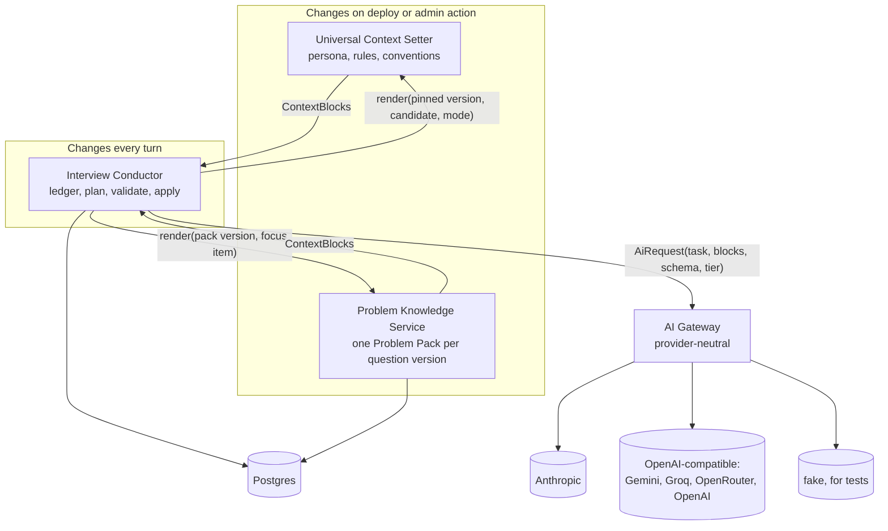

# Interview intelligence: overview

Status: implemented behind `INTERVIEWER_V3` (see [Implementation status](#13-implementation-status)) · Issue: [#23](https://github.com/mohitmotwani16/DesignRounds/issues/23)

This folder designs the parts of DesignRounds that make the live interviewer behave like a real one. There are three services and one shared platform layer:

| Doc | What it owns |
|---|---|
| [universal-context-setter.md](universal-context-setter.md) | Who the interviewer is, how an interview runs here, and who the candidate is. Same for every question. |
| [problem-knowledge-service.md](problem-knowledge-service.md) | What one question needs and how to judge answers to it: the **Problem Pack**. Same for every candidate. |
| [interview-conductor.md](interview-conductor.md) | One live round: the ledger of what's been asked and answered, what happens next, when to move on. |
| This file | How the three fit together, the provider-neutral AI gateway, tech choices, storage, caching and cost. |

A fourth service, the **Problem Setter**, is planned for later (section 9). It will research a new question on the internet and produce the inputs the Problem Knowledge Service turns into a pack.

## 1. How the three services fit



The three services share one rule: **they don't call each other's internals, and none of them knows which AI provider is in use.**

- UCS and PKS are pure **context producers**. Each returns a list of `ContextBlock`s (section 3), tagged with how stable they are. They never call a model at request time.
- The Conductor is the only service that runs during a turn. It asks the two producers for blocks, adds the live session blocks, and sends one provider-neutral `AiRequest` to the gateway.
- Only the gateway knows about providers. Swapping Claude for Gemini, or running both with failover, is a config change plus an eval run, never a change in any of the three services.

Independence in practice:

| | UCS | PKS | Conductor |
|---|---|---|---|
| Reads | Interviewer templates (repo), `users` profile fields | Briefs, guides, answer pools, `problem_packs` | Everything above through interfaces, plus session tables |
| Writes | Nothing at request time | `problem_packs` (build jobs only) | `interview_*` tables, `ai_credits`, `ai_usage` |
| Calls a model | Never | Only in offline build jobs | Once per learner turn, sometimes on a tick |
| Version | `ucs-<hash>` | `pack-<hash>` per question | Pins both at round start |
| Can be deployed alone | Yes (pure library) | Yes (read API + worker) | Yes (needs the other two over their interfaces) |

## 2. Deployment shape

**Decision: a modular monolith now, with boundaries strict enough to split later.**

All three run inside the existing Express app (`api/index.js` on Vercel, `server/index.js` long-running), each as its own module under `server/modules/` with a single `index.js` export. Rules that keep the boundaries real:

- A module only touches its own tables. The Conductor reads packs through `pks.getPack()`, never `select * from problem_packs`.
- Interfaces take and return plain JSON-serialisable objects, so any of them can become an HTTP or queue call later without changing callers.
- An ESLint `no-restricted-imports` rule enforces this: only `server/modules/<name>/index.js` may be imported from outside a module.

Why not separate services today: a learner turn already does credit reservation, turn insert and state update in **one Postgres transaction**, and splitting that across services means sagas for no user benefit. Adding network hops adds latency to the one path learners feel. The team is small. The first real candidate for extraction is PKS's build worker, because it does slow, bursty, offline work (section 8).

## 3. Shared contracts

### ContextBlock

The unit both producers return. It's what makes them provider-neutral: they describe *what* the text is and *how stable* it is, and the gateway decides how to cache it.

```ts
type ContextBlock = {
  id: string;                 // "ucs.system", "pks.pack.url-shortener", "conductor.ledger"
  role: "system" | "context"; // system instructions vs. user-side reference data
  text: string;               // already rendered and fenced (learner text escaped)
  stability: "global"         // same for every session: UCS core
           | "problem"        // same for every session of one question version: pack
           | "session"        // same for the rest of this round: candidate, assumptions
           | "turn";          // changes every turn: ledger, transcript, plan
  version: string;            // content hash; part of every cache key
  tokens: number;             // estimated at render time, for budgeting
};
```

Blocks are always assembled in stability order: `global → problem → session → turn`. That one ordering rule is what makes provider prompt caching work (section 6).

### AiRequest and AiResult

The only thing the Conductor (and PKS's builder) hand to the gateway:

```ts
type AiRequest = {
  task: "interviewer" | "interview_summary" | "review" | "communication" | "pack_build" | ...;
  tier: "fast" | "standard" | "deep";   // never a model name
  blocks: ContextBlock[];
  output: ZodSchema;                    // validated in our code, whatever the provider did
  stream?: { field: "message"; gate?: string[] }; // stream one string field; see conductor doc
  budget: { maxOutputTokens: number; timeoutMs: number };
  meter: { userId?: string; sessionId?: string; creditId?: string };
};

type AiResult<T> = {
  data: T;                              // schema-valid
  route: { provider: string; model: string; tier: string };
  usage: { input: number; cachedRead: number; cachedWrite: number; output: number; latencyMs: number };
};
```

`server/modules/ai/run.js` (`runTask`, `runTaskStream`) already has most of this shape. The change is that a task asks for a **tier** and passes **blocks**, instead of a string `system` and `buildUser` output.

## 4. The AI gateway (provider independence)

`server/modules/ai/` becomes the gateway. Its job is to turn one `AiRequest` into whatever a given provider needs, and to turn the provider's reply back into a schema-valid `AiResult`.

### Capabilities each adapter declares

| Capability | Anthropic (Messages API) | OpenAI-compatible (Gemini, Groq, OpenRouter, OpenAI) | Fallback if missing |
|---|---|---|---|
| Structured output | Native JSON-schema output, or a forced single tool | `response_format: json_schema` (strict) | JSON-only instruction + our zod validation + one repair round (exists today) |
| Streaming | SSE | SSE (exists) | Non-streamed reply, sent as one SSE frame (exists) |
| Prompt caching | Explicit `cache_control` breakpoints | Automatic prefix caching on most (OpenAI, Gemini implicit) | None; correctness never depends on caching |
| Reasoning effort | Effort / thinking budget | `reasoning_effort` (exists, with fallback to `low`) | Ignored |
| Token counts | Includes cache read/write tokens | Includes cached tokens where reported | Estimated |

The adapter maps `ContextBlock`s to the provider's format. For Anthropic, it puts cache breakpoints after the last `global` block and after the last `problem` block. For OpenAI-compatible providers it just keeps the order, since their caching is prefix-based and automatic. Services never see any of this.

### Routing tiers to models

```js
// config (env or a small JSON file), not code
AI_ROUTES = {
  fast:     [{ provider: "openai-compat", model: "gemini-flash-…" }],
  standard: [{ provider: "anthropic", model: "claude-sonnet-5-5", effort: "low" },
             { provider: "openai-compat", model: "gemini-…", effort: "low" }],   // failover
  deep:     [{ provider: "anthropic", model: "claude-sonnet-5-5", effort: "medium" }],
}
AI_TASK_TIERS = { interviewer: "standard", interview_summary: "fast", review: "deep", communication: "fast", pack_build: "deep" }
```

- **Failover** happens only on transport failures before any output (`RATE_LIMITED`, `PROVIDER_ERROR` 5xx, `NETWORK`), never on timeouts (the provider may still be billing) and never mid-stream.
- **Pinning.** A round records the route it started with in `interview_state.ai_route`, and the interviewer keeps using that model for the whole round unless it fails over. Switching models mid-interview changes the interviewer's voice.
- **Model ids in one place.** A new model is a config change plus an eval run (section 4.3).

### Implementation choice

**Decision: keep our own gateway interface. Write adapters with each vendor's official SDK (or plain `fetch`, as today for OpenAI-compatible).**

| Option | Verdict |
|---|---|
| Own interface + thin adapters (recommended) | We already have one adapter, streaming of a single JSON field, the repair loop and metering. An Anthropic adapter is about 200 lines with the official `@anthropic-ai/sdk`. Full control over caching and streaming. |
| Vercel AI SDK (`ai` + `@ai-sdk/*`) | Good multi-provider abstraction with structured output and streaming. Worth it if we add a third or fourth provider; it can sit *inside* our adapters without changing the interface. |
| LangChain / LlamaIndex | No. Our tasks are single schema-constrained calls, so an orchestration framework adds weight and hides prompts. |
| A hosted gateway (OpenRouter, LiteLLM proxy, Cloudflare AI Gateway) | Useful for failover and dashboards, but it adds a network hop and a third party seeing learner text. OpenRouter already works through the OpenAI-compatible adapter if we want it. |

### Prompts stay provider-neutral, and evals gate every model

- Templates are plain text with XML-style fences (`<brief>`, `<learner_design>`), which every major model handles. No provider-specific syntax in templates.
- Each `(task, template version, provider, model)` combination has to pass the eval suite (`npm run ai:eval`, extended with the conversation simulations in the conductor doc) before a route can point to it. The eval result is stored, and the gateway refuses at boot a route whose combination hasn't passed (overridable in development).

## 5. Technology choices

| Concern | Choice | Why / alternatives |
|---|---|---|
| Runtime | Node 24 LTS, ESM, Express (existing) | Already in place. Local machines need Node ≥ 22 (`process.loadEnvFile`, `node --test`). |
| Validation and schemas | zod (existing), converted to JSON Schema for providers (existing `toJsonSchema`) | One schema is both the provider contract and our validation. |
| Canonical store | Postgres: Supabase in production, PGlite locally (existing) | Transactions across credit, turn and ledger; jsonb for packs and ledger evidence. |
| Vector search | **None for now.** pgvector in the same Postgres when a real need appears | See section 7. |
| Hot cache | In-process LRU per instance; Postgres as the shared layer | Packs and UCS blocks are small and immutable per version. Add Upstash Redis only if cold starts make in-process caches useless (measured by `cache_miss` metrics). |
| Background jobs | Postgres job table with `for update skip locked` (the answer-pool pattern), drained by the long-running worker and by Vercel cron or an admin button | No new infrastructure. Move to a hosted queue (QStash, Inngest) when the Problem Setter's long web-gathering jobs arrive. |
| Real-time to the browser | SSE (exists since #52) | One-way streaming is all we need; WebSockets would add stateful connections on serverless. |
| Conductor state machine | Hand-written pure reducer (`plan`, `validate`, `apply`) | Small number of states. Pure functions are trivial to unit-test. XState would add a dependency and indirection without benefit here. |
| Token estimation | Character-based estimate at render time (about 4 chars/token), corrected by provider-reported usage | Exact tokenizers differ by provider; estimates are only for budgeting. |
| Observability | `ai_usage` table (exists), extended with tier, route, cached-read/write tokens and template versions; structured logs | OpenTelemetry later, if we adopt a tracing backend. |

## 6. Caching: never process the same input twice

Every artefact has a **content-addressed version** (a hash of exactly the inputs that produced it). Caches are keyed by version, so cache invalidation becomes "a new version exists", never "guess when this went stale".

| Layer | What is cached | Key | Where | Invalidated by |
|---|---|---|---|---|
| **L0 Built artefacts** | Problem Packs, plus each pack's pre-rendered prompt text | `hash(brief, guide, pool, builder template)` | Postgres `problem_packs` | A new input hash queues a rebuild; old versions stay for pinned rounds |
| | UCS system text | `hash(templates, policy)` | Computed at boot, memoised | Deploy |
| **L1 In-process memo** | Rendered UCS blocks, rendered pack blocks per focus item, `describeDiagram` output | `version` (+ focus item, mode) | LRU per instance | Never needed: keys change |
| **L2 Provider prompt cache** | The stable prefix: `global` and `problem` blocks, then `session` blocks | Provider-side, by exact prefix bytes | Provider | Provider TTL (minutes); we keep the prefix byte-identical to stay warm |
| **L3 Exact result cache** | Results that are pure functions of their inputs: review of an unchanged design (exists), a proactive canvas check on an unchanged `(diagram fingerprint, ledger version)`, pack builds, summaries per turn range | `hash(task, template version, inputs)` | Postgres (`ai_results` table, or the owning row) | Input hash changes |
| **L4 No model at all** | Opening, time checks, idle nudges, absorbed canvas changes | n/a | Code templates | n/a |

Rules that keep L2 effective (the biggest lever, since it applies to every turn):

- Nothing volatile goes in `global` or `problem` blocks: no timestamps, session ids, user names or "turn 7 of 40".
- Blocks render deterministically: sorted keys, stable ordering, no `Date.now()`.
- The candidate profile and mode go in a `session` block **after** the pack, so two candidates on the same question share the cached pack prefix.
- Providers require a minimum prefix length before they cache (on the order of a thousand tokens or more). The UCS + pack prefix is sized well above that.

**No semantic caching of interviewer replies.** Two learners never say the same thing in the same session state, and a "similar enough" cached reply would be wrong in exactly the ways that make an interviewer feel robotic. Exact-match caches only.

## 7. Do we need a vector database?

**Not for these three services.** Here's why, and where embeddings will start to earn their place.

- **Retrieval here is by key, not by similarity.** Everything the interviewer needs about a question is in its pack, and the pack is found by `prompt_id`. The catalog is about 50 questions now. Even at 1,000 questions, key lookup is the right tool.
- **A pack fits in the context window.** A pack renders to roughly 2–4k tokens, with only the focus item fully expanded. Putting all of it in context is cheaper, faster and more reliable than retrieving fragments, and with prompt caching most of it is billed at the cached rate.
- **Matching the learner's words to agenda items** ("did they just answer the code-generation item?") is done by the model inside the same call, with the compact ledger in view. A vector lookup would be a second, less accurate system doing the same job.
- **Session memory** is the ledger (structured), the rolling summary and recent turns. A 45-minute interview doesn't need semantic recall over itself.

Where embeddings will be useful, and the plan for each:

| Future need | Where | Store |
|---|---|---|
| Problem Setter: de-duplicate scraped sources, cluster how different sources answer, detect a near-duplicate of an existing question | Offline build jobs | **pgvector** in the same Supabase Postgres |
| "Read up on this" links from a missed agenda item to the 70+ Learn handbook topics | Pack build time (precomputed links stored in the pack) | pgvector, or no vectors at all if tags suffice |
| Cross-round learner memory ("you've struggled with caching across three rounds") | Profile-level feature, later | Structured aggregates first; vectors only if free text is needed |

Even then, the answer is pgvector inside the existing database, not a separate vector DB (Pinecone, Weaviate, Qdrant). It's one less system to secure and back up, and it can share transactions with the rows it describes.

## 8. Cost

Cost per learner turn is input tokens × price, minus caching, plus output. These levers are listed roughly by impact.

| Lever | Where | Effect |
|---|---|---|
| **One model call per learner turn** | Conductor | The plan and the ledger updates are code; the model only judges and writes. |
| **Stable-prefix prompt caching** | Gateway + block ordering | Most of every turn's input (UCS + pack) is billed at the provider's cached-input rate, a fraction of the normal rate. |
| **Focus expansion** | PKS render | Only the item under discussion is expanded; the rest of the agenda is one line each. |
| **Ledger instead of transcript replay** | Conductor | Recent turns stay capped (24), older ones fold into the summary, and the ledger carries what's been covered. Input stays flat as a round gets longer. |
| **Model tiers** | Gateway routes | Summaries and extraction on `fast`; the interviewer on `standard` at low effort; reviews and pack builds on `deep`. |
| **No-model ticks** | Conductor | Time checks, nudges and absorbed canvas changes are templates. |
| **Exact result caches** | L3 | Unchanged design → no new review (exists); unchanged canvas → no new proactive check. |
| **Batch APIs for offline work** | PKS builder, evals | Pack builds and eval runs aren't latency-sensitive, so they go through provider batch APIs, which are billed at a discount. |
| **Output caps** | Task budgets | Short messages (about 120 words), capped assessment lists. |
| **Allowances in code** | `plans.js` (exists) | Per-round and per-month caps are enforced before any call. |

Measuring it: every call records tier, route, input, cached-read, cached-write and output tokens in `ai_usage`. A daily admin view shows cost per round, the cache hit rate per task, and cost per question. An alert fires if the cache hit rate for `interviewer` drops, which usually means something volatile leaked into a prefix block. Prices change, so cost is computed from a small `ai_prices` config table rather than hard-coded.

### Cost per round versus price

The interviewer is the main thing Plus sells, so its unit cost has to be known **before Plus checkout launches**. Work it out from current provider prices at that time (not from memory), with this model:

```
per turn  = fresh_in × price_in + cached_in × price_cached_read + cache_writes × price_cache_write + out × price_out
per round = turns × per turn + review + communication + summaries
```

Starting assumptions for a heavy round, to be replaced with measured `ai_usage` numbers from shadow mode:

| Input | Assumption |
|---|---|
| Learner turns per round | 40 (the Plus per-round cap) |
| Input tokens per turn | ~9k, of which ~4k cacheable |
| Cache hit rate | 0% and 70% (compute both: low traffic may see almost no cross-learner hits) |
| Output tokens per turn | ~450 |
| Model-backed ticks | ~5 per round |
| Final reviews | 1–3 per round (the Plus cap) |

Deliverables: cost per typical round and per worst-case round (all caps used), the **gross margin per Plus month** at the expected usage, and the price or allowance change needed if margin is too thin. Recompute whenever a route's model changes.

## 9. Later: Problem Setter service

> **Status: planned, not part of this design iteration.** Only its boundary is defined here, so PKS is built ready for it.

An admin gives the Problem Setter a short description of a question they want to add ("Design a distributed rate limiter for a public API, intermediate"). It then:

1. Researches public sources on the internet: engineering blogs, talks and transcripts, documentation, forum discussions. This extends today's `server/modules/answers/gather.js` (robots-aware fetching, private-address blocking, short attributable excerpts only).
2. Drafts the **inputs** PKS consumes: a brief (description, requirements, considerations, expected outcome), an interviewer guide in the six-section format, and an answer pool.
3. Hands those drafts to an admin for review. Once approved, they're saved where briefs, guides and pools live today, and PKS builds the pack from them through its normal pipeline.

The boundary that matters now: **PKS never depends on how its inputs were produced.** Whether a guide was hand-written or drafted by the Problem Setter, PKS sees the same `ProblemInputs` record (see [problem-knowledge-service.md](problem-knowledge-service.md#3-inputs)). This is also where pgvector is likely to appear first (section 7).

## 10. Safe rollout

Nothing here should break current rounds:

- **Additive migrations only.** New tables and nullable columns. Nothing existing is renamed or dropped until the old path is retired.
- **Versions are pinned per round.** A round started on today's interviewer (v2) finishes on v2. A round started with a pack keeps that pack version and UCS version even if newer ones are published mid-round.
- **Flags at two levels.** `INTERVIEWER_V3` per environment, and per question (a question uses the Conductor only if it has a published pack).
- **Shadow mode first.** The Conductor plans and judges alongside v2, which keeps writing the messages. Ledgers are compared offline before anything is learner-visible. Shadow mode sends real learner text through an extra processing path, so it needs the privacy step in section 11 first.
- **Fallbacks at every step.** No pack → guide-only prompt (today's behaviour). Provider down → failover route → the existing "AI unavailable" state. Invalid output → one repair → a templated move. A cache miss is only ever slower, never wrong.

Phases, in order: baseline (success-measure instrumentation and simulations on v2) → gateway and tiers → UCS → PKS packs for 5 free questions with admin review → privacy update and opt-in → Conductor in shadow → calibration and cost check → [launch checklist](#launch-checklist) → Conductor live for those 5 → pacing and wrap-up → ledger-fed review and debrief → all questions → retire v2.

## 11. Success measures and launch checks

### How we'll know it worked

Measured on Conductor rounds against a baseline of v2 rounds on the same questions, over the same period:

| Measure | How it's collected | Target |
|---|---|---|
| **Realism rating** | One question after each round: "How much did this feel like a real interview?" (1–5), with an optional comment | Mean rating higher than v2 |
| **Rounds reaching the deep dive** | Share of rounds whose ledger reaches the `deep_dive` stage, from `interview_events` | Higher than v2 |
| **Repeat-question complaints** | Thumbs-down on interviewer messages tagged "already asked" or "repeating itself" (a small reason picker on the thumbs-down) | Lower than v2 |

Supporting signals: the share of required items closed per round, the move-on rate per question, round completion rate, and whether learners start another round within 7 days. The first three measures are the go/no-go for expanding beyond the first five questions.

### Calibration against real interviewers

Simulations test behaviour; only people can test whether the judging is right. Before the Conductor goes live:

1. Recruit 2–3 people who run system design interviews.
2. Take about 20 transcripts (shadow-mode rounds with consent, plus simulated ones) spread across at least 3 questions and a range of quality.
3. Each labeller marks every agenda item as strong / adequate / weak / not covered, without seeing the model's bands.
4. Compare: agreement between labellers, and between labellers and the model, per item and per dimension.

Acceptance: the model agrees with the labellers' majority about as often as the labellers agree with each other, and it never rates an item strong when the labellers' majority said weak (or the reverse). Disagreements go back into pack evidence descriptors and the eval suite. Repeat the exercise when the `standard` route's model changes.

### Privacy and consent

Before shadow mode on real rounds, and before any second production provider receives learner text:

- Update the [privacy page](../../src/pages/Privacy.jsx): which providers process interview text and voice transcripts, that answers may be used to evaluate and improve the interviewer, and how long that data is kept.
- Get explicit opt-in for using a learner's rounds in shadow comparisons and calibration labelling; rounds without opt-in are never shown to labellers.
- Sign a data processing agreement with every provider on a production route, and confirm its data-retention and training terms. Free tiers that train on inputs stay development-only (as the Gemini free tier is today).
- Strip names and emails before transcripts go to human labellers.

### Launch checklist

- [ ] Simulation suite passing on every routed model, with a v2 baseline recorded
- [ ] Calibration acceptance met
- [ ] Cost per round and Plus margin worked out (section 8)
- [ ] Privacy page updated, opt-in in place, provider agreements signed
- [ ] Rate limit on `POST /interview/tick` (see the [conductor doc](interview-conductor.md#6-ticks))
- [ ] Success measures instrumented, so v2 and v3 can be compared from day one

## 12. Open decisions

1. **Second production provider.** Recommendation: Anthropic as primary for `standard` and `deep`, an OpenAI-compatible provider as failover and for `fast`. This needs a data-processing agreement with each before real learner text goes there; the dev-only Gemini free tier stays test-data-only.
2. **Redis.** Recommendation: not yet. Add it only if measured in-process cache misses or lock contention justify it.
3. **Extracting PKS's builder into its own worker deployment.** Recommendation: when the Problem Setter starts, not before.
4. **Eval gate strictness.** Recommendation: block in production, warn in development.

## 13. Implementation status

Built in the `feature/interview-intelligence` branch, behind `INTERVIEWER_V3` (on in development, opt-in in production) and per question (only questions with a published pack).

**Built as designed**

- **UCS** (`server/modules/ucs`): content as files in `server/content/interviewer` (policy, persona, format, behaviours, moves, output, modes, task addenda, `conventions.json`); boot validation of files and `{{placeholders}}`; `ucs-<hash>` versions; `ucs_versions` retention for pinned rounds, pruned by maintenance; deterministic blocks labelled by stability; candidate snapshot without personal data; a committed snapshot of the rendered core (`server/modules/ucs/fixtures/ucs-core.txt`) so prompt changes show up in review. `prompts/policy.js` now reads `policy.md`, byte-identical.
- **PKS** (`server/modules/pks`): `packSchema` plus structural rules (stage coverage, ids, pacing, curveballs, Learn slugs, component kinds, exemplar leakage, and hidden facts never stated unprompted); content-hash versions; `problem_packs` and the `problem_pack_jobs` queue; hand-authored packs imported and published at boot; the builder (`pack_build`, one strong-model call, one repair round on rule failures, a fast consistency check against the guide); deterministic pre-rendered blocks with focus expansion; the admin review tab (diff against published, edit as a new draft, publish, retire, rebuild).
- **Conductor** (`server/modules/conductor`): ledger, events, pure `plan` / `validate` / `apply` / `ticks`, gated streaming (`move` and `focusItemId` are checked before any text is shown; a rejected move gets one retry, then a template), quote verification (typed and noisy voice), the clock and pacing, modes, ticks with their own rate limit and one-in-flight guard, the tick result key, the templated time checks, nudges and wrap-up, the ledger-fed review, the debrief, the realism rating and per-message feedback. Five packs are hand-authored for the first free questions.
- **Gateway**: tasks can pass context blocks; `run.js` orders them by stability and marks cache boundaries, which the Claude adapter turns into `cache_control` breakpoints; `ai_usage` records cached input tokens.
- **Evaluation**: unit tests for every rule (`npm run test:conductor`), an end-to-end smoke of a whole v3 round (`npm run test:smoke:v3`), and conversation simulations with a candidate-simulator model (`npm run ai:sim`).

**Different from the design, and why**

- **Routing.** Instead of `AI_ROUTES` tiers with failover between providers, each task names its model in `server/modules/ai/config.js`, and chat tasks fall back from Gemini 3.8 Flash (us multi-region) to Gemini 3.5 Flash (Mumbai) when the first token doesn't arrive in time. One provider (Vertex) is in production today; tiers can be added when a second production provider is.
- **Ticks may stay silent.** A model-backed tick can choose `stay_silent` (the v2 "skip"): the credit is released and the canvas absorbed.
- **Mode switch.** Besides `POST /sessions { interviewMode }`, the interviewer panel offers Guided or Realistic until the learner first speaks (`POST /interview/mode`), because most rounds are started from buttons that don't show a mode choice.
- **Batch API for builds** isn't used: Vertex's OpenAI-compatible endpoint has none, and builds are rare and run offline anyway.

**Still to do before launch** (unchanged from section 10 and the [launch checklist](#launch-checklist))

- Baseline on v2 (the realism rating and feedback endpoints already work on v2 rounds), shadow mode, the privacy page update and opt-in, calibration with real interviewers, and the cost per round. None of these is code that can be finished in a branch.
- The eval gate at boot (refusing an unevaluated route) and the ESLint import-boundary rule.
