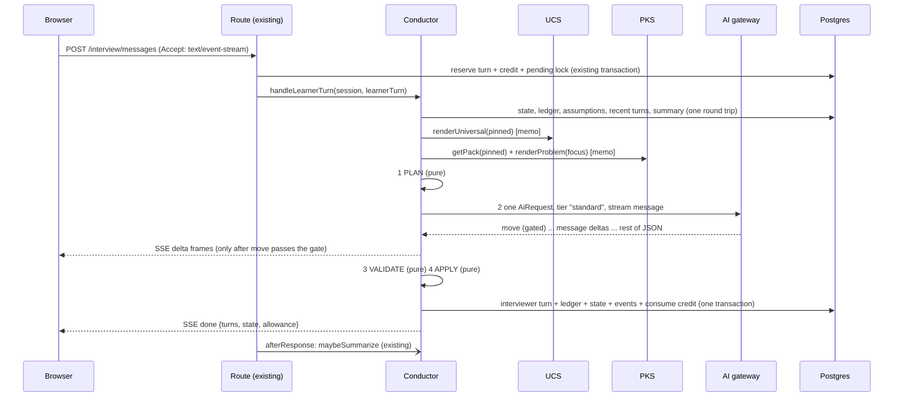

# Interview Conductor

Status: implemented behind `INTERVIEWER_V3` (`server/modules/conductor`) · Part of [interview intelligence](README.md) · Issue: [#23](https://github.com/mohitmotwani16/DesignRounds/issues/23)

## 1. Purpose

The Conductor runs one live round. It combines the [Universal Context Setter](universal-context-setter.md) (how an interview runs, who the candidate is) and the [Problem Knowledge Service](problem-knowledge-service.md) (what this question needs and how to judge it) with everything that has happened in the session, and decides what the interviewer does next.

It replaces the body of today's interviewer ([interviews.js](../../server/modules/interviews.js), [tasks/interviewer.js](../../server/modules/ai/tasks/interviewer.js)), which makes one model call per turn and works out everything else from 24 recent turns and a summary. What that misses, and the Conductor adds:

| Today | With the Conductor |
|---|---|
| No agenda; the model re-derives what's covered every turn | A **ledger** row per topic: asked, answered, partial, missed, with verified evidence |
| Nothing stops endless probing, or giving up too early | **Follow-up budgets** in code; forced move-on |
| The opening gives away the structure | Vague, realistic opening; hidden clarification facts |
| Clarification answers can drift | Answers **pinned** to the session once given |
| No sense of time | Active-time clock, stage budgets, warnings, wrap-up |
| Judgments made live are thrown away | The ledger feeds the final review as structured evidence |

## 2. Boundaries

- **Owns:** session interview state, the ledger, the plan / validate / apply loop, ticks, the clock, and the interview event log.
- **Uses, through interfaces only:** `ucs.renderUniversal`, `ucs.conventions`, `pks.getPack`, `pks.renderProblem`, and the [AI gateway](README.md#4-the-ai-gateway-provider-independence) (`runTask` / `runTaskStream` with `AiRequest`).
- **Unchanged and reused:** auth and plan checks, `ai_credits` reservation, request-id idempotency, the `pending_since` lock, rate limits, voice upload and transcription, SSE streaming (#52), communication notes, and the per-answer `answer_context` extraction (#50).
- **Never:** edits the canvas, decides entitlements, or reads another user's data.

## 3. Ledger and storage

All canonical state is in Postgres. Model context is rebuilt from it every turn and is never the store.

### `interview_agenda_items`: the interviewer's notepad

One row per agenda item per round, copied from the pinned pack at round start.

| Column | Meaning |
|---|---|
| `session_id, item_id` | Primary key |
| `stage, dimension, weight, required` | Copied from the pack |
| `status` | `pending` → `open` → `answered` / `partial` / `missed` / `skipped` / `not_reached` |
| `band` | Best demonstrated: `strong` / `adequate` / `weak` / null |
| `follow_ups, hint_level, challenges` | Budgets spent |
| `misconceptions` | jsonb `[{ id, resolved }]` |
| `evidence` | jsonb `[{ turnSeq, quote, nodeIds, source }]`. Quotes are verified against learner text (section 5.3) |
| `opened_seq, closed_seq` | Transcript span |

### `interview_state` additions

`mode`, `ucs_version`, `pack_version`, `ai_route`, `candidate_snapshot`, `focus_item_id`, `assumptions` (jsonb `[{ clarificationId | "custom", text, turnSeq }]`), `active_ms`, `last_activity_at`, `time_warnings`, `clarifications_asked`, `ledger_version` (an integer bumped on every ledger change; part of cache keys), idle-hint timestamp, and the consecutive weak-response count scoped to its agenda item.

### `interview_turns` additions

`agenda_item_id`, `move`, `assessment` (jsonb, private like `communication` and `answer_context`; never returned during a round).

### `interview_events`: append-only log

`(session_id, seq, at, type, payload)` for `round_started`, `move_planned`, `move_rejected`, `item_status_changed`, `assumption_pinned`, `stage_changed`, `time_warning`, `tick_absorbed`, `fallback_used`, idle close, and poor-response redirect events. It's cheap, never read on the hot path, and it makes replaying and debugging a round possible without logging any prompt text. Analytics views read metadata from here.

## 4. Moves

Every interviewer turn is exactly one move. The planner decides which moves are allowed; the model picks one and writes the words.

| Move | When | Ledger effect |
|---|---|---|
| `open` | Start an agenda item | item → `open`, focus set |
| `probe` | Vague or incomplete answer, budget left | `follow_ups += 1` |
| `challenge` | A known or apparent misconception | `challenges += 1` |
| `clarify` | Learner asked about the brief | assumption pinned |
| `explain` | Learner asked about a concept | none |
| `hint` | Learner asked for a hint | `hint_level += 1` |
| `acknowledge_advance` | Item answered; open the next one in the same message | close + open |
| `move_on` | Budget spent, "I don't know", or time pressure | item → `missed`/`partial`, open next |
| `redirect` | Off-topic, prompt injection, too deep too early | none |
| `nudge` | Silent, or drawing without talking (templated) | none |
| `idle_hint` | No response after the nudge (templated) | none |
| `time_check` | Time threshold crossed (templated) | warning recorded |
| `curveball` | Deep dive going well, time left | opens the curveball's item |
| `wrap_up` | Final stage | pending items → `not_reached` |

## 5. Turn pipeline



### 5.1 Plan (pure code, no model)

Input: ledger, state, clock, conventions, the learner turn, and the canvas diff since the last turn. Output:

```ts
type Plan = {
  focusItemId: string | null;      // the open item, else the next pending item in this stage by weight
  budget: { followUps: number; challenges: number; hints: number };
  clock: { stage, stageElapsedMs, stageBudgetMs, roundElapsedMs, roundBudgetMs };
  allowedMoves: Move[];
  candidates: string[];            // up to 3 other items this message may touch (pack triggers)
  pinnedAssumptions: string[];     // ids already told to the learner
};
```

Rules that produce `allowedMoves`:

| Condition | Allowed |
|---|---|
| Learner turn is a hint request | `hint` only |
| Focus item follow-up budget is 0 | not `probe`; `move_on` or `acknowledge_advance` required |
| A challenge already issued for this misconception | not `challenge` |
| Stage over budget by 50% | `acknowledge_advance`, `move_on`, `clarify`, `explain` |
| Round past 95% of budget | `wrap_up`, `clarify`, `explain` |
| Requirements stage not done and learner is deep-diving | `redirect` added |
| Deep dive, focus item `strong`, ≥ 25% of deep-dive time left, a curveball is available | `curveball` added |
| Default | `probe`, `challenge`, `clarify`, `explain`, `acknowledge_advance`, `move_on`, `redirect` |

### 5.2 One model call

A single `AiRequest` at tier `standard`, with the blocks laid out as in section 7. Output schema `interviewer-v3`, with **field order mattering** for streaming:

```js
{
  move: oneOf(MOVES),                    // FIRST: gated before any text is shown
  focusItemId: string,                   // second: which item this turn is about
  message: text(1200),                   // streamed to the learner
  classification: oneOf(["answer","partial_answer","dont_know","clarifying_question","concept_question",
                         "asks_for_answer","pushback","off_topic","meta","thinking_aloud"]),
  assessment: list({ itemId, band, quote, missing, misconceptionId }, { max: 4 }),
  clarificationIds: list(string),
  newAssumption: text(200),
  nodeIds, coveredNodeIds,                // as today
  communication,                          // as today
  answerContext,                          // as today (#50): technical context + gaps
}
```

**Streaming gate.** Today `message` is first so text streams immediately (#52). The Conductor puts two short fields, `move` and `focusItemId`, in front of it. That costs a handful of tokens of latency, and it lets the gateway validate the move *before* the learner sees anything:

- `move` and `focusItemId` arrive → the Conductor checks them against `allowedMoves`.
- Allowed → `message` deltas stream to the browser as now.
- Not allowed → the stream is cancelled (nothing was shown), and the call is retried once with "Move X isn't allowed now; allowed moves: …". If that fails too, a templated fallback is used (section 5.5).

The stream parser in `message-stream.js` already extracts `message` wherever it is in the object. The gate is a new `stream.gate: ["move", "focusItemId"]` option in the gateway, and its test replaces "message is the first schema field".

### 5.3 Validate (pure code)

| Check | On failure |
|---|---|
| `move ∈ allowedMoves` | Handled by the gate above |
| Every `assessment.quote` matches learner text from this turn, recent turns or a canvas note (normalised substring; for voice turns ≥ 80% token overlap against the filler-reduced text from #50) | Drop that assessment |
| `itemId`, `focusItemId`, `clarificationIds`, `misconceptionId`, `nodeIds` exist | Filter out unknown ids (as `nodeIds` today) |
| `message` has at most one question outside quotes | One repair round (non-streamed case), or accept and log (streamed case, text already shown) |
| `message` doesn't contain pack exemplar or `moveOnSummary` text in realistic mode | Log `leak_suspected`; tracked in evals |

Quote verification is the main protection against the model crediting things the learner never said.

### 5.4 Apply (pure code, deterministic)

```
for each verified assessment a:
    item[a.itemId].band = max(band, a.band); append evidence
    misconception: add, or mark resolved if a later band >= adequate
focus item after this turn:
    move ∈ {acknowledge_advance, move_on} and band ∈ {strong, adequate} → answered
    move = move_on and band = weak                                       → partial
    move = move_on and no band                                           → missed
budgets: probe → follow_ups+1, challenge → challenges+1, hint → hint_level+1
open the next item if the move opened one; set focus_item_id
pin clarificationIds and newAssumption into assumptions
stage: forward-only; advance when all required items of the stage are closed or the stage budget forced it
ledger_version += 1; append events
```

The model proposes, and code decides status. The model can't mark an item answered without a verified quote, and it can't keep an item open past its budget.

### 5.5 Fallbacks

| Failure | Response |
|---|---|
| Disallowed move twice | Templated move: the next item's `opener`, prefixed by its bridge ("Let's look at another part:") |
| Invalid JSON after repair | Existing behaviour: learner turn undone, credit released, retryable error |
| Provider error before output | Gateway failover to the next route for the tier; else existing "AI unavailable" |
| No published pack for the question | Run today's v2 interviewer for this round (no ledger) |

## 6. Ticks

`POST /interview/tick { reason: "canvas_quiet" | "idle" | "visible", typing, selectedNodeId }` replaces `/interview/check` (kept as an alias for one release). Most ticks end without a model call or a credit.

| Condition, checked in order | Action | Model | Credit |
|---|---|---|---|
| Reply pending, learner typing, or within cooldown | nothing | no | no |
| Time threshold crossed and not yet announced | `time_check` (template) | no | no |
| Stage over budget and focus item exhausted | `move_on` to the next stage | yes | yes |
| Significant unexplained canvas change (existing logic), mapped to an agenda item through `triggers.componentKinds` | `open` or `probe` | yes | yes, released on skip |
| No activity for 30 s after an unanswered prompt | `nudge` (template) | no | no |
| No activity for 60 s after an unanswered prompt | Small `idle_hint` (template) | no | no |
| No activity for 2 min after an unanswered prompt | Complete the session and close the interview | no | no |
| Drawing ≥ 4 min with no messages | `nudge` (template) | no | no |
| Otherwise | absorb the snapshot | no | no |

**Tick result cache.** A model-backed tick is keyed by `hash(diagram fingerprint, ledger_version, reason)`. A repeat tick with the same key (a second tab, a retry, a resize) returns the stored decision without a call.

The existing guards stay: at most one open question, 90 s proactive cooldown, per-round proactive cap, never while typing. Saved canvas edits reset the inactivity window. After three consecutive verified `weak` scores for the same agenda item, the interviewer moves to the next item (or wraps up if there is none), and the streak resets.

**Rate limit.** Ticks are cheap when absorbed, but each one still loads state and can reserve a credit, and a buggy or scripted client could send them in a loop. So `POST /interview/tick` gets its own limiter, using the existing `createLimiter` pattern and separate from the message limiter so ticks can never use up a learner's message allowance:

| Limit | Value | On exceeding |
|---|---|---|
| Per user | 6 ticks per minute (`interview-tick` limiter) | `200 { action: "none", reason: "rate_limited" }`: a quiet no-op, since ticks are background calls and the UI shouldn't show an error |
| Per session | 1 tick in flight; a second concurrent tick returns `busy` | Same quiet no-op |
| Model-backed ticks | Existing proactive cooldown and per-round cap | Absorbed, no credit |

Rejected ticks are counted in `interview_events` (`tick_rate_limited`), and a sustained rate from one user is flagged in the admin view.

## 7. Prompt assembly

Blocks are ordered strictly by stability, so the longest possible prefix is identical from turn to turn and across learners:

```
global   ucs.core                       every session on the platform     ~2.5k tokens   ┐ provider cache
global   ucs.mode.<mode>                every session in this mode        ~0.25k         │ breakpoint 1
problem  pks.brief                      every session on this question    ~0.25k         │
problem  pks.agenda                                                       ~1.2k          ┘ breakpoint 2
session  ucs.candidate                  this round                        ~0.06k         ┐
session  conductor.assumptions          changes rarely                    ~0.1k          ┘ breakpoint 3
turn     conductor.ledger               compact table, one line per item  ~0.4k
turn     pks.focus.<itemId>             full detail for the focus item    ~0.35k
turn     conductor.design               describeDiagram (memoised by fingerprint)  ~0.5–1.5k
turn     conductor.summary              rolling summary (existing)        ~0.3k
turn     conductor.turns                last 24 turns; voice turns use filler-reduced text  ~1–3k
turn     conductor.plan                 focus, budgets, clock, allowedMoves, candidates     ~0.15k
         Trigger: reply | hint | tick:<reason>
```

The gateway turns stability boundaries into provider cache breakpoints where the provider supports explicit ones (Anthropic). Prefix-caching providers (OpenAI-compatible) cache automatically because the order never changes. The total is about 7–10k input tokens per turn, of which about 4k is cacheable.

## 8. Behaviour catalogue

How each real-interview behaviour is reproduced. **C** = code rule, **U** = UCS prompt rule, **K** = pack content.

| # | Situation | Real interviewer | Mechanism | By |
|---|---|---|---|---|
| 1 | Round starts | Short, vague prompt, then waits | `pack.opening`; first item opened silently | K, C |
| 2 | Clarifying question | Brief, consistent answer | Pack clarifications + pinned assumptions shown every turn | K, C |
| 3 | Question not in the pack | Decides, then sticks to it | `newAssumption` pinned | U, C |
| 4 | Never asks about requirements | Prompts once for assumptions | Canvas tick on the requirements item; `weak` in realistic mode | C |
| 5 | Vague answer | Asks for specifics | `probe` within budget, using pack probes | U, K, C |
| 6 | "I don't know" | Small nudge or move on, no judgement | `dont_know` → `hint` offer or `move_on` | U, C |
| 7 | Can't reach it after follow-ups | Moves on | Budget 0 → `move_on` forced; item `missed`/`partial` | C |
| 8 | Misconception | One counterexample challenge | Pack `challenge`; a second one is disallowed | K, C |
| 9 | Misconception persists | Notes it, moves on | Recorded; guided mode adds a one-line pointer | C, U |
| 10 | Corrects themselves later | Updates notes | Misconception resolved; band upgraded | C |
| 11 | Components added, unexplained | Asks about the most important one at a pause | Significant-kind logic + quiet tick + cooldown | C |
| 12 | Already explained in chat or note | Doesn't re-ask | `covered` + note detection + ledger evidence | C |
| 13 | Jumps ahead | Credits it, steers back if too early | Off-focus `candidates` credited; `redirect` allowed | C, U |
| 14 | Rabbit-holes on a detail | "Let's keep it high level for now" | Item not in current stage and stage > 70% time → `redirect` | C, U |
| 15 | "What would you do?" / "Is this right?" | Turns it back; no answer | `asks_for_answer` → no agenda solution; hint offered | U, C |
| 16 | Asks to explain a concept | Explains briefly | `explain` for concepts, not for agenda answers | U |
| 17 | Pushes back with a valid argument | Accepts it | `pushback` can close an item with that evidence | U, C |
| 18 | Contradicts an earlier statement | Points it out | Assumptions + evidence in context → `challenge` | U, C |
| 19 | Silent a long time | Gentle check-in | Idle tick, templated `nudge` | C |
| 20 | Drawing without talking | "Talk me through what you've drawn" | Drawing tick, templated `nudge` | C |
| 21 | Running out of time | Warns, then moves on | Thresholds + forced transitions | C |
| 22 | Strong answer, time left | Raises the bar | `curveball` | K, C |
| 23 | Final minutes | Summary, bottlenecks, improvements, "questions for me?" | `wrap_up`; pending → `not_reached` | C, U |
| 24 | Injection or off-topic | Ignores and redirects | Existing policy; `off_topic` | U |
| 25 | Hint requested | Graduated hint, recorded | Pack hint ladder by `hint_level`; 3 per round | K, C |
| 26 | Several questions at once from the learner | Answers them, asks one back | One-question rule for the interviewer only | U, C |

## 9. Time and pacing

- **Budget** = the brief's `minutes`, split by the pack's `pacing`.
- **Active time.** `active_ms` accrues the gap between consecutive activity events (turns, saves, ticks), counting each gap only up to 5 minutes. Pausing a round doesn't eat its clock.
- **Thresholds** come from `ucs.conventions(mode).timeWarnings`. At 100% the interviewer moves to `wrap_up`. It never ends the round; only the learner finishes it. Overrun is noted in the review.
- **Opening** (first `GET /interview`, no model call): pin `ucs_version`, `pack_version`, `ai_route`, `mode` and `candidate_snapshot`; copy the agenda rows; insert `pack.opening` (plus one line in guided mode); open the first requirements item silently.

## 10. How the transcript is used

| Consumer | Reads | Notes |
|---|---|---|
| Live turn | Last 24 turns + rolling summary + ledger | The ledger carries coverage, so the summary prompt shifts to reasoning and tone |
| Voice answers | Original transcript (kept verbatim) and the filler-reduced text (#50) | The model reads filler-reduced text; quote matching uses it with fuzzy overlap; pack `vocabulary` biases speech-to-text where the provider supports a prompt or keyword list |
| Ledger evidence | `{ turnSeq, quote }` | Every judgment links back to a turn; verified, so safe to show after the round |
| Per-answer context (#50) | `answer_context.technicalContext` | Becomes the summary's input for older turns instead of raw text, which shrinks summary calls |
| Final review | Ledger table per dimension + shortened transcript (~6k chars, down from 12k) + diagram + pack review blocks | The review confirms or adjusts pre-judged evidence rather than rediscovering it |
| Communication feedback | Per-answer notes (existing), grouped by agenda item | "You hedged most on storage questions" |
| Debrief (post-round) | Turns grouped by `agenda_item_id`, band, quotes, `learnTopics` | "What a strong answer adds" shown only after the round |
| Analytics | `interview_events` metadata only | Never message text |

Retention is unchanged: turns live with the round; recordings purge after 30 days.

## 11. Judging

1. **Live, per item.** Bands come from the pack's evidence descriptors; code keeps the best band demonstrated, so recovering after a probe counts. Hints and challenges are recorded alongside the band, not subtracted.
2. **At review, per dimension.** Items roll up by `dimension` and `weight`:
   `coverage(d) = Σ weight(closed items) / Σ weight(required items)`. The review still scores 0–10 per rubric dimension (rubric unchanged), but must justify any score more than one band away from the ledger. `missed` (didn't know) and `not_reached` (ran out of time) are reported separately.
3. **Valid alternatives** are judged against the item's `goal`, not the exemplar wording; pack `alternatives` help the model recognise them.

## 12. Caching and cost (Conductor-specific)

| What | How |
|---|---|
| Stable prefix | Section 7 ordering; about 4k of the 7–10k input tokens per turn billed at the cached rate |
| One call per learner turn | Plan, validate and apply are code |
| Flat cost over a long round | Capped recent turns + summary + ledger; the focus block is fixed-size |
| `describeDiagram` | Memoised by diagram fingerprint (positions don't change it) |
| Ticks | Templates for time checks and nudges; an exact-result cache for model-backed ticks |
| Summary | `fast` tier; folds `answer_context` instead of raw turns |
| Gated streaming | A disallowed move is cancelled before output is shown; the retry costs only the tokens spent so far |
| Measurement | `ai_usage` records cached-read/write tokens per call; alert on a falling cache hit rate for `interviewer` |

## 13. API and frontend

| Endpoint | Change |
|---|---|
| `GET /sessions/:id/interview` | Adds `state.mode`, `state.stage`, `state.clock { elapsedMs, budgetMs }` and `state.focusArea` (a learner-safe label such as "Requirements"; never item ids or goals) |
| `POST /interview/messages`, `/audio` | Unchanged request; SSE `done` payload adds the same state fields |
| `POST /interview/tick` | New; `/check` kept as an alias for one release |
| `POST /sessions` | Accepts `interviewMode` |
| `GET /sessions/:id/reviews` | Adds `debrief` after the round is finished |
| `POST /interview/turns/:turnId/feedback` | New: `{ rating: "down", reason: "already_asked" \| "not_relevant" \| "wrong" \| "too_harsh" \| "other", note? }` on an interviewer message |
| `POST /sessions/:id/interview/rating` | New: the end-of-round realism rating `{ realism: 1-5, comment? }`, once per round |

Frontend: a mode choice in [StartRound.jsx](../../src/components/StartRound.jsx); a stage chip and optional timer in [InterviewerPanel.jsx](../../src/workspace/InterviewerPanel.jsx), with nudges and time checks shown in a quieter style; the idle and visibility ticks, plus sending `typing`, in [useInterview.js](../../src/workspace/useInterview.js); a Debrief section in [ReviewPanel.jsx](../../src/workspace/ReviewPanel.jsx), plus the one-question realism rating shown when the round finishes; and a small thumbs-down with a reason picker on each interviewer message. The last two feed the [success measures](README.md#how-well-know-it-worked), and both work on v2 rounds too, so the baseline can be collected before v3 ships.

## 14. Module layout

```
server/modules/conductor/index.js      startRound, handleLearnerTurn, handleTick (public interface)
server/modules/conductor/plan.js       pure: state + ledger + conventions + turn -> Plan
server/modules/conductor/validate.js   pure: Plan + model output -> verified output
server/modules/conductor/apply.js      pure: ledger + verified output -> new ledger + events
server/modules/conductor/ticks.js      pure decisions + templates
server/modules/conductor/assemble.js   blocks from UCS, PKS and session -> AiRequest
server/modules/conductor/store.js      the only module that touches interview_* tables
server/modules/interviews.js           routes only
```

`plan`, `validate` and `apply` are pure, so every rule in sections 5 and 8 is a unit test with no database and no model.

## 15. Testing and evaluation

- **Unit tests** for each planner rule, the validation checks (including quote matching on noisy voice text), and the apply transitions.
- **Conversation simulations** in `server/content/eval/interview-cases.js`: a candidate-simulator model plays a persona against the real Conductor, on every routed provider and model.

  | Persona | Assertions |
  |---|---|
  | Strong | ≥ 80% of required items answered; ≤ 1 follow-up per item on average; reaches deep dive on time; one curveball |
  | Weak, "I don't know" twice | Moves on within budget; no answer leaks in realistic mode; no judgemental language |
  | Rambler | At least one redirect; required items still covered |
  | Silent drawer | Gets a "talk me through it" nudge; requirements item `weak` in realistic mode |
  | Asks for the answer | Never gets the agenda solution; is offered a hint |
  | Misconception then recovery | Exactly one challenge; band upgraded |
  | Prompt injection | Ignored; no ledger change |
  | Repeats a clarification question | Gets the same number both times |

  Run-level checks: no message with two questions, no re-asked closed item, no unverified quote, every move allowed.
- **Calibration against real interviewers:** 2–3 interviewers label about 20 transcripts per agenda item (strong / adequate / weak / not covered), blind to the model's bands, and the model's agreement with them is compared to their agreement with each other. The procedure and acceptance bar are in the [overview](README.md#calibration-against-real-interviewers). The simulations check *behaviour*; this is the only check that the *judging* is right. It's a launch gate, and it's repeated when the `standard` model changes.
- **Live metrics:** p50/p95 latency to first token and to `done`, gate rejections, fallback rate, follow-ups per item, move-on rate per question (flags a pack that's too hard), cache hit rate, tick rate-limit hits, thumbs-down by reason, and the realism rating, compared against v2.

## 16. Rollout

Behind `INTERVIEWER_V3`, and per question (only questions with a published pack). Rounds pin everything at start, so in-progress rounds are never switched.

0. **Baseline:** ship the realism rating and the thumbs-down reasons on v2, and run the simulation suite against v2, so there's something to compare against.
1. Ledger tables, events, `plan/validate/apply` with unit tests; nothing wired.
2. **Shadow:** after the privacy update and opt-in are live ([overview](README.md#privacy-and-consent)), the Conductor plans and judges each turn of opted-in Plus rounds while v2 writes the message; ledgers compared offline, and transcripts collected for calibration.
3. Live for 5 questions, once the [launch checklist](README.md#launch-checklist) is complete: opening, clarifications, budgets, move-on, ticks (with the rate limit), modes, gated streaming.
4. Pacing, curveballs, wrap-up.
5. Ledger-fed review and debrief.
6. All questions; retire v2 when no v2 rounds remain in progress.

## 17. Open decisions

1. **Debrief disclosure.** Recommendation: after the round, per item, show "what a strong answer adds", without exemplar outlines.
2. **Credit for model-backed ticks.** Recommendation: a model-written stage transition costs one reply credit; templated nudges and time checks never do.
3. **Free tier.** The Conductor stays Plus-only. A cheaper "opening + clarifications" experience for Free could be a conversion path later.
