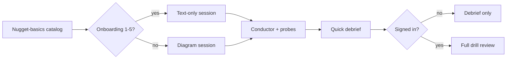

# Nugget-basics

Short **incident-style** drills that teach the Nugget flow before full parent-round nuggets.

## Locked product decisions

| Topic | Decision |
|--------|-----------|
| Name | **Nugget-basics** |
| Language | **English only (v1)** — symptoms, openers, debriefs, UI |
| Onboarding | **5 text-only** drills (global sequence); diagram from drill 6 onward |
| Matrix | **168** drills = 7 tracks × 8 components × 3 difficulties |
| Tracks | **Separate tabs** per library track (including Distributed systems) |
| Interviewer | **Full Conductor + probes** (same as production nuggets) |
| Access | **Anonymous** users may start drills |
| Anonymous review | **Debrief only** until sign-in (no full drill review / communication tab) |
| Signed-in review | Full drill review when implemented for basics sessions |

## Onboarding sequence (text-only)

1. Uneven traffic → load balancer  
2. Read amplification → cache  
3. Capacity limit → sharding / partitioning  
4. Stale reads → invalidation / consistency  
5. Hot spot → hot key / spread load  

## Content source of truth

- Authoring modules: `server/content/nugget-basics/tracks/*.js`, `onboarding.js`
- Build: `node server/content/nugget-basics/build-catalog.mjs`
- Generated catalog: `server/content/nugget-basics/catalog.json` (173 rows: 5 + 168)

## Learner flow



## Build and content

```bash
npm run nuggets:basics
```

Writes `server/content/nuggets/nugget-basics.*.json` (173 drills) from `server/content/nugget-basics/catalog.json`.

## Runtime

- `parentPromptId`: `nugget-basics` in `src/data/prompts.js` (hidden from main library)
- API: `GET /v1/nugget-basics/catalog`, `POST /v1/nugget-basics/sessions`
- Guest cookie `dr_guest`; migrations `028`, `029`
- `basics.format`: `text-only` | `diagram` on each nugget; workspace hides canvas when `text-only`
- Anonymous: debrief in chat only; Review tab shows sign-in CTA (`drillReview.debriefOnly`)

## Related

- Full nuggets: `server/content/nuggets/`, `server/modules/nuggets/schema.js`
- Conductor: `docs/design/interview-conductor.md`