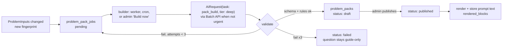

# Problem Knowledge Service (PKS)

Status: implemented (`server/modules/pks`, packs in `server/content/packs`) · Part of [interview intelligence](README.md)

## 1. Purpose

The PKS turns everything known about one question into a **Problem Pack**: a structured, versioned description of what an interview on that question should cover, what the interviewer reveals when asked, and how to judge answers. It renders that pack into context blocks for the Conductor and the final review.

It is the question's side of the interview, the same for every candidate. It knows nothing about users or sessions.

## 2. What it does not do

- No model calls at request time. Packs are built offline and read by key.
- It doesn't run interviews, track sessions, or score rounds.
- It doesn't research the internet for new questions. That's the future [Problem Setter](README.md#9-later-problem-setter-service), which produces the PKS's *inputs*. (Today's answer-pool gathering stays where it is until then.)
- Nothing it holds reaches the browser during a round.

## 3. Inputs

The PKS consumes one normalised record per question. It doesn't care whether a person or the Problem Setter wrote it.

```ts
type ProblemInputs = {
  promptId: string;
  brief: {                      // src/data/prompts.js + server/content/round-briefs.js (Plus)
    title, description, difficulty, minutes, requirements[], considerations[], expectedOutcome, prerequisites[]
  };
  guide: { text, version } | null;    // server/content/guides/<track>.md (six required sections)
  pool: AnswerPool | null;            // answer_pools.pool, status 'ready'
  fingerprint: string;                // sha256 of all of the above
};
```

`inputsFor(promptId)` assembles this from today's sources. When the Problem Setter exists, it writes to the same places (or to new tables behind the same function). The PKS doesn't change.

## 4. The Problem Pack

The pack is plain JSON, validated by a zod schema (`packSchema`). The full field list:

```jsonc
{
  "schemaVersion": 1,
  "promptId": "url-shortener",
  "version": "pack-3f9a12c0",        // sha256 of the canonical JSON (sorted keys), first 8 hex
  "inputsFingerprint": "…",          // which ProblemInputs produced it
  "builder": "pack-builder-v1/claude-sonnet-5-5",

  "opening": "Let's design a URL shortener, something like bit.ly. Where would you like to start?",

  "clarifications": [                // hidden facts, revealed only when asked
    { "id": "scale.writes", "topics": ["scale", "traffic", "users", "writes"],
      "answer": "Assume about 100 million new links a month." },
    { "id": "scale.ratio", "topics": ["read write ratio", "reads"],
      "answer": "Reads dominate, roughly 100 redirects per link created." },
    { "id": "scope.analytics", "topics": ["analytics", "click counts"],
      "answer": "Basic click counts, but they must not slow down redirects." }
  ],
  "clarificationPolicy": "Decide anything unlisted in a way that keeps the problem at the brief's difficulty.",

  "agenda": [                        // what the interview should touch; not the only valid design
    {
      "id": "deep.codegen",
      "stage": "deep_dive",          // requirements | high_level | deep_dive | wrap_up
      "dimension": "data",           // a rubric.js dimension id
      "weight": 3, "required": true,
      "triggers": { "componentKinds": ["kv-store", "id-generator"], "keywords": ["short code", "base62", "hash"] },
      "goal": "A collision-free code scheme that works across many instances.",
      "opener": "How does the service generate a short code, and how do two servers avoid issuing the same one?",
      "evidence": {
        "strong":   "Counter/range allocation + base62, or random + uniqueness check, with keyspace math and the multi-instance story.",
        "adequate": "A plausible scheme, but the multi-instance collision story is vague.",
        "weak":     "Hash of the URL with no collision handling, or 'use a UUID' with no length concern."
      },
      "misconceptions": [
        { "id": "md5-unique", "pattern": "Believes truncating a hash guarantees uniqueness.",
          "challenge": "What happens when two different URLs hash to the same first seven characters?" }
      ],
      "probes": ["Walk me through two API servers creating a link in the same millisecond."],
      "hints":  ["Could each server own a block of numbers?", "Counters plus an encoding that turns numbers into short strings is one route."],
      "moveOnSummary": "Range-allocated counters with base62 are one standard answer.",
      "learnTopics": ["unique-id-generation", "hashing"]   // Learn handbook slugs for the debrief
    }
    // typically 8-14 items across the four stages
  ],

  "curveballs": [
    { "id": "viral", "after": "deep.cache", "prompt": "One link goes viral at a million hits a minute. What breaks?", "agendaItemId": "deep.hotkey" }
  ],

  "vocabulary": ["base62", "301", "302", "Redis", "Cassandra", "DynamoDB", "TTL", "Snowflake ID"],
  "alternatives": [{ "choice": "Random codes with a uniqueness check", "whenBetter": "When sequential codes must not be guessable." }],
  "exemplars":    [{ "band": "strong", "label": "…", "outline": "…" }],   // from the answer pool; review only
  "pacing": { "requirements": 0.15, "high_level": 0.30, "deep_dive": 0.40, "wrap_up": 0.15 }
}
```

How each part is used:

| Field | Used by | Purpose |
|---|---|---|
| `opening` | Conductor at round start | A realistic, deliberately vague first line |
| `clarifications` | Conductor every turn | Consistent hidden facts; the same question always gets the same answer |
| `agenda` | Conductor's ledger and planner | Topics, judging descriptors, follow-up and hint material, move-on bridges |
| `triggers` | Conductor's planner | Cheap, code-side candidate matching (component kinds on the canvas, keywords). A data model kind (`table`, `fact-table`, `dimension-table`, `collection`, `event-schema`) marks the item as being about the data model: it then needs a table drawn ([conductor doc](interview-conductor.md#the-data-model)) |
| `curveballs` | Conductor in deep dive | Raise the bar when the learner is doing well |
| `vocabulary` | Speech-to-text and judging | Fewer mis-transcribed terms in voice answers |
| `alternatives`, `exemplars` | Final review | Calibration; credit valid alternatives |
| `learnTopics` | Post-round debrief | "Read more" links into `/learn` |
| `pacing` | Conductor clock | Stage time budgets scaled to `brief.minutes` |

## 5. Building packs



**Trigger.** On boot (and nightly) the PKS computes `inputsFingerprint` for every question, as `syncAnswerPools` already does for pools. A new fingerprint without a pack queues a job. The pool is an input, so the job waits until the pool is `ready` (or proceeds without one after 24 hours, recording `pool: null`).

**Builder.** One `pack_build` task through the gateway at tier `deep`. Its input is `ProblemInputs` with UCS's `pack_build` addendum; its output is `packSchema`. Builds aren't latency-sensitive, so the gateway sends them through the provider's **batch API** when one is available. A full rebuild of the catalogue happens rarely and costs little.

**Validation** in code, before anything is saved:

- zod schema (lengths, enums, ids unique, dimension ids exist in `rubric.js`).
- Structural rules: every stage has at least one `required` item; every item has all three evidence bands, at least one probe and at least one hint; `pacing` sums to 1; `curveballs[].agendaItemId` exists; `learnTopics` exist in the Learn catalogue.
- Consistency with the guide: clarification numbers agree with the guide's "Scope and scale". This is checked by a second `fast`-tier pass that returns `{ consistent, conflicts[] }` and is reviewed by the admin anyway.
- Leakage: no exemplar outline appears verbatim in `opening`, `probes` or `hints`.

**Human review.** Packs land as `draft`. A new Admin tab shows the pack next to its guide and pool, with a diff against the currently published version, and buttons to publish, rebuild or retire. `PROBLEM_PACKS_AUTOPUBLISH=on` skips review in development only. Admins can also hand-edit a draft; an edit produces a new `version` (content hash) and keeps `builder: "manual"`.

**Hand-authored packs.** For a flagship question, a pack can be committed as `server/content/packs/<prompt-id>.json`. It goes through the same validation and lands as `published`, which is useful for the first five questions while the builder is tuned.

## 6. Storage

All in Postgres. Packs are immutable once saved, so every version can be cached forever.

```sql
create table problem_packs (
  prompt_id text not null,
  version text not null,                  -- content hash of `pack`
  inputs_fingerprint text not null,
  status text not null check (status in ('draft','published','retired','failed')),
  pack jsonb not null,
  rendered jsonb not null,                -- pre-rendered blocks, see section 7
  builder text not null,                  -- "pack-builder-v1/<model>" or "manual"
  validation jsonb not null default '{}', -- consistency check result, warnings
  reviewed_by uuid references users (id),
  published_at timestamptz,
  created_at timestamptz not null default now(),
  primary key (prompt_id, version)
);
create unique index problem_packs_one_published on problem_packs (prompt_id) where status = 'published';

create table problem_pack_jobs (          -- the answer-pool queue pattern
  prompt_id text primary key,
  inputs_fingerprint text not null,
  status text not null check (status in ('pending','building','done','failed')),
  attempts integer not null default 0,
  error_code text,
  updated_at timestamptz not null default now()
);

alter table problem_packs enable row level security;
alter table problem_pack_jobs enable row level security;
```

- **Size.** A pack is roughly 10–30 KB of JSON. Even 1,000 questions × 5 retained versions is well under a gigabyte, so no object storage is needed.
- **Retention.** `retired` versions are kept while any round pins them (`interview_state.pack_version`), then deleted by the maintenance job after 30 days.
- **Why not files only?** Hand-authored packs *start* as files, but builder output, admin review state and version history need a database. Files are imported into `problem_packs` at boot.
- **No vector index.** Packs are fetched by `(prompt_id, version)`. See the [overview](README.md#7-do-we-need-a-vector-database) for when pgvector comes in.

## 7. Interface and rendering

```js
// server/modules/pks/index.js
export async function publishedVersion(promptId): Promise<string | null>
export async function getPack(promptId, version): Promise<ProblemPack>        // immutable
export function renderProblem(pack, { task, focusItemId, mode }): ContextBlock[]
export async function packStatus(promptId): Promise<{ status, version, builtAt }>
```

What `renderProblem` returns for the interviewer:

| Block id | Stability | Content | Approx. tokens |
|---|---|---|---|
| `pks.brief` | problem | Title, difficulty, description, requirements | ~250 |
| `pks.agenda` | problem | Every agenda item as **one line** (`id · stage · dimension · goal`), plus the clarification facts and the curveball list | ~1,200 |
| `pks.focus.<itemId>` | turn | The focus item in full: evidence bands, misconceptions, probes, hints, move-on summary | ~350 |

For the review it returns `pks.brief`, the full agenda with evidence descriptors, `alternatives` and `exemplars`, all at `problem` stability. That's a different block set, so it gets its own cache prefix.

Focus expansion is what keeps cost flat as packs grow. The model always sees the whole agenda in one line per item (so it can credit out-of-order coverage), but full detail only for the item under discussion. When the focus moves, the cached prefix (`pks.brief` + `pks.agenda`) doesn't change; only the small turn block does.

**Pre-rendering.** `brief` and `agenda` text for each task, plus a `focus` text per item, are rendered once at publish time and stored in `problem_packs.rendered`, together with token estimates. At request time the PKS only looks them up. Rendering is deterministic (sorted keys, fixed formatting), so the bytes, and therefore the provider cache, are stable across instances and deploys.

## 8. Caching and cost

| Layer | What | Key | Notes |
|---|---|---|---|
| Build | Whole pack | `inputs_fingerprint` | A question is only rebuilt when its brief, guide or pool actually changes |
| Storage | Pre-rendered blocks | `(prompt_id, version)` | Rendered once at publish |
| In-process | Pack and rendered blocks | `(prompt_id, version)` | Immutable, so the cache never needs invalidation; LRU bounds memory |
| `publishedVersion` lookup | Current published version per question | `prompt_id` | Cached 60 s in process; only used at round start, since rounds pin the version |
| Provider | `pks.brief` + `pks.agenda` | Exact prefix bytes | Shared by every learner on the same question; billed at the cached rate after the first turn |

Cost summary: build cost is one `deep` call per question version, discounted through batch. It's paid once per question version, not per learner. Request-time cost is zero model calls, one indexed DB read per instance per pack version, and around 1.5k cacheable prompt tokens per turn.

## 9. Provider independence

- Packs are JSON data, not prompts. Nothing in them is model-specific, so the same pack works with any provider.
- The builder is an ordinary gateway task at tier `deep`. Changing which model builds packs is a route change; packs built by different models coexist, recorded in `builder`.
- The rendered text uses the same neutral fences as everything else.

## 10. Testing

- Schema and validation rules: fixtures for a valid pack and one fixture per rule violation.
- Render determinism: same pack → same bytes (hash comparison), and focus-expanded blocks contain no exemplar text.
- Builder eval: for the five hand-authored packs, build from inputs and compare structure (stages covered, required-item overlap, clarification agreement) against the hand-authored version. This gates builder template changes.
- Bundle check: `check-build.mjs` extended so no pack text (probes, hints, evidence) appears in the browser bundle.

## 11. Migration from today

1. Add the tables. Import nothing yet: the interviewer and review keep using guide + pool exactly as now.
2. Hand-author packs for five free questions in `server/content/packs/`. Ship the Admin review tab.
3. Ship the builder; build drafts for the rest; review and publish in batches.
4. The review task starts reading `pks.renderProblem({ task: "review" })` when a pack exists, and today's guide + pool otherwise. `reviewTemplateVersion` gains the pack version.

Answer pools stay as they are and become one of the pack's inputs. When the Problem Setter arrives, it takes over gathering, and `answers/` either moves into it or stays as its first stage.
