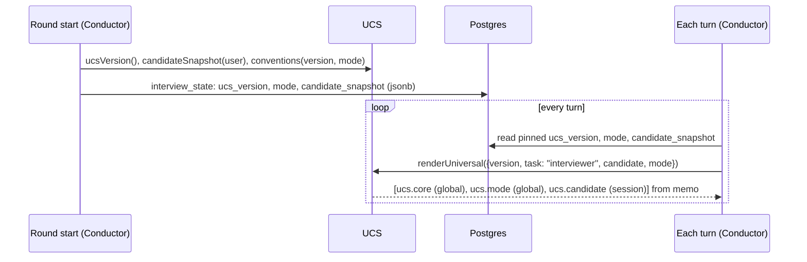

# Universal Context Setter (UCS)

Status: draft for review · Part of [interview intelligence](README.md) · Scope: design only

## 1. Purpose

The UCS produces the context that is true for **every interview, whatever the question**: who the interviewer is, how an interview runs on DesignRounds, the rules it must follow, and a short, safe description of the candidate and the round's mode. It knows nothing about URL shorteners or chat systems. That's the Problem Knowledge Service's job.

It exists as a separate service for three reasons:

- **One source of truth for interviewer behaviour.** Today the policy lives in `prompts/policy.js` and the interviewer rules are inline in `tasks/interviewer.js`. The review, communication and summary tasks each restate parts of them. The UCS holds them once, versioned.
- **Caching.** Its core output is byte-identical for every session on the platform, so it's the first and most valuable block of the provider prompt cache.
- **Safe change.** Changing the persona, or how hints work, is a reviewed template change with a new version and an eval run. It isn't a code edit scattered across tasks.

## 2. What it does not do

- It doesn't call a model, at request time or ever.
- It doesn't read problem content (briefs, guides, packs) or session content (turns, ledger).
- It doesn't decide entitlements. Plans, credits and limits stay in `plans.js`, and the UCS only states in text that the application handles them.
- It doesn't store per-session data. The Conductor pins the UCS version and a candidate snapshot on the session.

## 3. Interface

```js
// server/modules/ucs/index.js
export function ucsVersion(): string                      // e.g. "ucs-7c1e09ab"

export function renderUniversal({ version, task, candidate, mode }): ContextBlock[]
//  version   : pinned on the round; must be the current version or one still retained
//  task      : "interviewer" | "review" | "communication" | "interview_summary" | "pack_build"
//  candidate : CandidateSnapshot (below), or null for tasks that don't need it
//  mode      : "guided" | "realistic"

export function conventions({ version, mode }): Conventions   // numbers the Conductor's code uses

export function candidateSnapshot(user): CandidateSnapshot    // taken once at round start
```

It returns `ContextBlock`s (see the [overview](README.md#3-shared-contracts)). What comes back for the interviewer task:

| Block id | Stability | Content | Approx. tokens |
|---|---|---|---|
| `ucs.core` | global | Shared policy + interviewer persona + interview format + behaviour rules + move vocabulary + output conventions | ~2,500 |
| `ucs.mode.<mode>` | global (one per mode) | The differences for Guided vs Realistic | ~250 |
| `ucs.candidate` | session | The candidate snapshot rendered as two or three lines | ~60 |

Two candidates on the same question in the same mode share every byte up to `ucs.candidate`. That's why `ucs.candidate` comes *after* the problem pack in final assembly (see the Conductor's [prompt layout](interview-conductor.md#7-prompt-assembly)). The UCS doesn't control ordering; it just labels stability honestly.

### Types

```ts
type CandidateSnapshot = {
  targetTracks: string[];            // from users.interests, practice tracks only
  level: "student" | "early" | "mid" | "senior" | null;   // new optional onboarding field
  roundsCompleted: number;           // bucketed: 0, 1-3, 4-10, 10+
};
// Deliberately excluded: name, email, organisation, free-text bio, past scores.

type Conventions = {
  maxFollowUpsPerItem: number;       // guided 3, realistic 2
  maxChallengesPerMisconception: 1;
  hintsPerRound: number;             // read from plans.js, not owned here
  idleNudgeMs: 180_000;
  drawingWithoutTalkingMs: 240_000;
  proactiveCooldownMs: 90_000;
  timeWarnings: number[];            // guided [0.5, 0.8], realistic [0.8]
  oneQuestionPerMessage: true;
  messageWordLimit: 120;
};
```

Numbers live in `Conventions` so that **code** enforces them (the Conductor's planner reads them) and the **prompt** describes the same numbers, rendered from the same object. The model and the code can't drift apart.

## 4. Storage: config-as-code

**Decision: UCS content is versioned files in the repository, not database rows.**

```
server/content/interviewer/
  policy.md              shared policy (moved from prompts/policy.js, unchanged text)
  persona.md             who the interviewer is, tone
  format.md              stages, what each is for, how a round flows
  behaviours.md          the behaviour catalogue as rules (see the conductor doc)
  moves.md               the move vocabulary and when each is allowed
  modes/guided.md
  modes/realistic.md
  tasks/review.md        task-specific addenda for non-interviewer tasks
  tasks/communication.md
  tasks/summary.md
  conventions.json       the numbers above, per mode
```

Why files instead of database rows:

- These change through code review, together with the code and evals that depend on them. A database-edited prompt could change behaviour in production without an eval run.
- They ship with the deploy, so every instance has the same version at the same time.
- They're server-only like guides today: never under `src/`, added to Vercel's `includeFiles`, and covered by `check-build.mjs` so no fragment reaches the browser bundle.

**Versioning.** At boot the UCS loads all files, validates them (every required file present, every `{{placeholder}}` resolvable from `Conventions`), and computes `ucsVersion = "ucs-" + sha256(all file contents, sorted by path).slice(0, 8)`. A missing file or a bad placeholder fails startup, as missing guide sections do today.

**Retaining old versions for pinned rounds.** A round pins the UCS version it started with. When a deploy changes UCS content, rounds already in progress should finish on the old text. So:

- At boot, the UCS writes its rendered `ucs.core` and mode blocks to a small table, `ucs_versions (version, task, mode, text, created_at)`, insert-only and deduplicated by version.
- `renderUniversal({ version })` serves the current version from memory, and an older version from that table (memoised after the first read).
- Versions older than 14 days with no in-progress rounds are deleted by the daily maintenance job.

This is the only thing the UCS writes, and it writes it at boot, not per request.

## 5. How data reaches each round



- The candidate snapshot is taken **once**, at round start. If the learner edits their profile mid-round, the round isn't affected, so the session block and its cache stay stable.
- The final review calls `renderUniversal({ task: "review" })` with the same pinned version, so the reviewer and the interviewer judged the round under the same rules.

## 6. Modes

The mode is chosen on the round start screen and stored on `interview_state.mode`. It can't change mid-round, because it changes how the round is judged.

| | Guided | Realistic |
|---|---|---|
| Default for | Beginner prompts, and `level = student` | Everything else |
| Opening | Vague prompt plus one line on how the round works | Vague prompt only |
| Acknowledgements | Says what was good | Neutral ("Okay, go on.") |
| After moving on from a miss | One-line pointer to what to read up on | Short bridge only |
| Follow-ups per item | 3 | 2 |
| Time warnings | 50% and 80% | 80% |
| Concept explanations when asked | Yes, short | Yes, shorter; no worked answers |

## 7. Caching and cost

| What | Cached where | Key | Cost effect |
|---|---|---|---|
| Loaded and validated templates | Process memory, at boot | `ucsVersion` | No file I/O per request |
| Rendered blocks | In-process memo | `(version, task, mode)`; candidate block by `hash(snapshot)` | Rendering is microseconds; memo mostly avoids allocation churn |
| Older pinned versions | `ucs_versions` table, then memo | `version` | One DB read per instance per old version |
| `ucs.core` on the provider | Provider prompt cache, as the first prefix segment | Exact bytes | The biggest saving: about 2.5k tokens per turn billed at the cached rate across *all* sessions on the platform |

To keep that last row working:

- `ucs.core` contains no dates, counts or names. Anything that varies goes into `ucs.candidate` or later blocks.
- Changing UCS text invalidates every provider cache at once. That's expected on deploy, but it's a reason to batch prompt edits rather than ship many small ones.

## 8. Provider independence

The UCS emits plain text with XML-style fences and Markdown headings, which every major model follows. It never emits provider syntax (no `cache_control`, no tool definitions, no role tricks). Its blocks are tagged `role: "system"`, and the gateway maps that to the provider's system field, or to a leading user message for providers without one.

Some wording does land differently on different models. When it does, the fix is a mode or task addendum that passes evals on **all** routed models, not a per-provider fork of the persona. If a fork ever becomes unavoidable, it becomes `persona.<provider>.md` with its own eval gate, and the version hash still covers it.

## 9. Testing

- Unit tests: boot validation (missing file, bad placeholder), deterministic rendering (same inputs → same bytes, checked by hash), and no volatile content in `global` blocks (a test fails if a rendered `ucs.core` contains digits that look like timestamps or uuids).
- Eval gate: any `ucsVersion` change runs `npm run ai:eval` (review cases + conversation simulations) against every routed model before merge (CI job).
- Snapshot test: the rendered `ucs.core` is committed as a fixture, so reviewers see the exact prompt diff in the PR.

## 10. Migration from today

1. Move `prompts/policy.js` text to `server/content/interviewer/policy.md`, unchanged, and keep `policyVersion` working as an alias so stored reviews remain comparable.
2. Move the interviewer, review, communication and summary instruction text into `tasks/*.md`. Each task gets its system text from `renderUniversal`.
3. Add `ucs_versions`, plus `interview_state.ucs_version`, `mode` and `candidate_snapshot`.
4. Add the optional experience-level question to onboarding.

Steps 1–2 are behaviour-neutral (byte-for-byte the same prompts), which can be verified by snapshot comparison before anything else changes.
